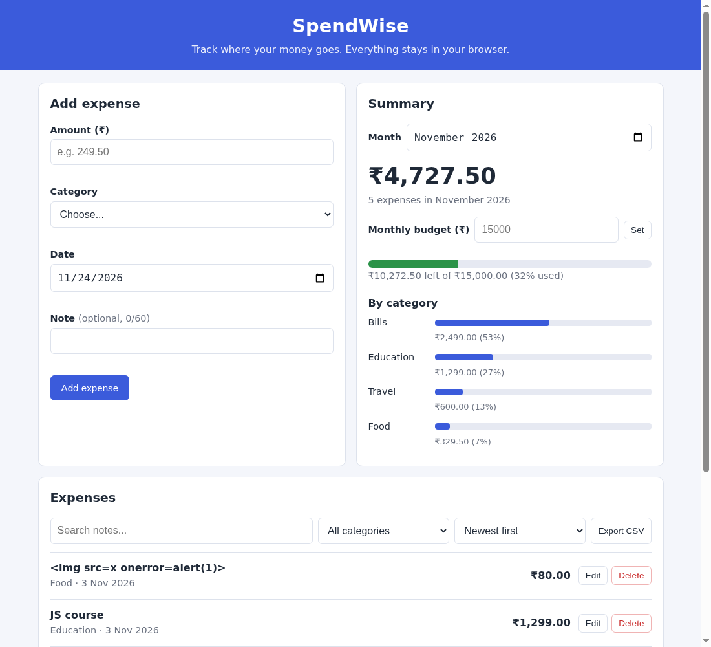

# SpendWise: Expense Tracker

A small expense tracker I built for **Task 3 (Practical Implementation Project)** of the YuvaIntern Frontend Development Fresher Internship. It uses only plain HTML, CSS and JavaScript (no frameworks, no build step), the same tools I used in Task 1 and Task 2.



## What it does

- Add an expense with amount, category, date and an optional note
- Edit or delete an expense (delete has a 5-second **Undo**)
- See the total for any month, with a bar chart split by category
- Set a monthly budget and watch a progress bar (green, then orange above 80%, red when over)
- Search notes, filter by category, sort by date or amount
- Export the current view as a CSV file
- Data is saved in the browser with `localStorage`, so it is still there after refresh

## How to run

1. Download or clone the repo
2. Double-click `index.html` (any modern browser). No install, no server.

To run the tests: open `tests/index.html` in a browser, or run `node tests/tests.js` (39 tests).

## Project structure

```
spendwise-expense-tracker/
  index.html          page layout, three sections (form, summary, list)
  css/style.css       styles, mobile first, 2 columns from 800px
  js/
    utils.js          pure helper functions (money, dates, validation, filter, CSV)
    storage.js        the only file that touches localStorage
    store.js          app data + add/update/remove + notify subscribers
    form.js           add/edit form component
    summary.js        total, budget bar, category chart component
    list.js           filters, expense list, undo, CSV export component
    app.js            starts everything and connects the components
  tests/
    index.html        browser test page
    tests.js          39 unit tests, hand-written runner
  screenshots/
```

## Architecture

```
 user action
     |
 form.js / list.js / summary.js      (components: read input, draw UI)
     |  call add / update / remove
 store.js                            (single source of truth)
     |  save()                 |  notify subscribers
 storage.js -> localStorage      app.js renderAll() -> summary.js + list.js redraw
```

Data flows one way: components never edit the data themselves. They ask the store, the store saves and then tells the components to redraw.

### Data model

Saved under the key `spendwise.v1`:

```json
{
  "version": 1,
  "budgetPaise": 1500000,
  "expenses": [
    { "id": "lq3k9x1ab", "amountPaise": 24950, "category": "Food",
      "date": "2026-11-03", "note": "Biryani", "createdAt": 1764000000000 }
  ]
}
```

## Decisions and why

| Decision | Why |
|---|---|
| Money stored as integer paise | `0.1 + 0.2` is `0.30000000000000004` in JavaScript. Integers add exactly. |
| Dates stored as `YYYY-MM-DD` strings | They sort correctly as text and avoid timezone shifts. |
| `todayISO()` built from local date parts | `toISOString()` uses UTC and gave yesterday's date after midnight in India. |
| Classic `<script>` tags, not ES modules | Modules do not load from `file://`, so the app would not open by double-click. |
| `textContent` instead of `innerHTML` for user text | A note such as `` is shown as text and cannot run. |
| One store with subscribers | The list and the total always change together. |
| Versioned storage key | A future format change can migrate `v1` data instead of breaking it. |
| Chart made from `div` widths | Needs no library, loads instantly, and is easy to read in code. |

## Edge cases handled

- Empty, zero, negative, letters, `1e5`, `1.2.3`, more than 2 decimals, or a huge amount
- Commas in amounts (`1,25,000`) are accepted
- Impossible dates like 31 Feb, and future dates
- Note over 60 characters, very long words without spaces (layout wraps them)
- Adding an expense in a different month than the one being viewed (view jumps to that month)
- Editing an expense that was already deleted
- Corrupted or hand-edited localStorage: bad items are skipped, bad JSON is backed up and the app starts fresh
- localStorage blocked or full: the app still works and shows a warning
- CSV notes with commas, quotes, or a leading `=` (spreadsheet formula)
- Empty states: no data, and no results for a filter

## Testing

- `tests/tests.js`: 39 unit tests for amount parsing, money format, date checks, validation, filtering, sorting, totals and CSV.
- Manual checklist: add, edit, delete + undo, refresh persistence, month switch, budget colours, search, export, narrow phone width (360px), keyboard only (Tab, Enter).

## Performance notes

- Search waits 200ms after typing stops before redrawing (debounce).
- The chart and list are redrawn once per change from one place (`renderAll`).
- Object URLs created for CSV export are released after the download.
- No libraries: the whole app is about 34 KB of source, including HTML and CSS.

## What I would improve next

- Recurring expenses and a yearly view
- Import from CSV
- Real charts using the Canvas API
- Moving the components to a framework (this project made me understand what a framework would automate)

## What I learned

Splitting code by responsibility (storage, store, components) made bugs much easier to find. Validating input in one pure function made it easy to test. Most of my bugs came from edge cases, not from the happy path.

Author: Venkatesh Pola, github.com/Venky10008
